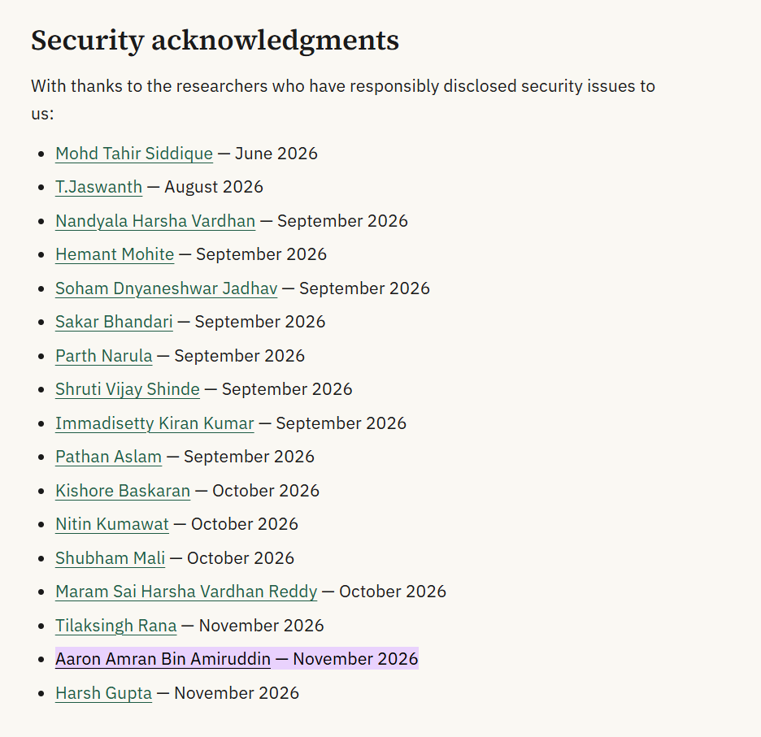

TOLVYN

<h1 class="writeup-title">TOLVYN Code Vulnerability</h1>

November 2026 &mdash; Vulnerability Disclosure Program

On 19 November 2026, I did static code analysis and created a vulnerability Proof of Concept that was reported to and accepted by TOLVYN. You can find <a href="https://tolvyn.io/pages/security" target="_blank" rel="noopener noreferrer">TOLVYN's VDP here</a>.

You can see their responsible disclosure rules in the screenshot above.

<section class="text-center" style="margin-top:1.5rem; margin-bottom:1.5rem;">

See you in the next hack.

@aaronamran

November 2026

</section>

